# Halo in the browser and on every platform (FractumSeraph's fork)

**Play it now in your browser: [halo.fractumseraph.net](https://halo.fractumseraph.net/)**,
[download it](#download) for Windows, Mac, Linux, FreeBSD and Android, or play it on a
**New Nintendo 3DS: [Fractum Halo 3DS](https://github.com/FractumSeraph/Fractum-Halo-3DS)**
or a **smartwatch: [fractum-halo-android32.apk](https://github.com/FractumSeraph/OpenCE/releases/latest/download/fractum-halo-android32.apk)**
(Wear OS watches with a 32-bit Android, such as the Galaxy Watch 8 Classic).

This fork combines [OpenCE](https://github.com/OpenCommunityEdition/OpenCE)
and [ChupathingyCE](https://github.com/ChupathingyCE/chupathingyce), the two
ports of the Halo: Combat Evolved decompilation, and keeps up with both.
Below: what only this fork has, then how it differs from the two, then
everything else. Further down are [ChupathingyCE's](#chupathingyce) and
[OpenCE's](#opence) own pages.

## Only in this fork

Neither OpenCE nor ChupathingyCE has these.

- **Halo on the New Nintendo 3DS.** [Fractum Halo 3DS](https://github.com/FractumSeraph/Fractum-Halo-3DS)
  ([download](https://github.com/FractumSeraph/Fractum-Halo-3DS/releases/latest)) is
  Generalkidd's Halo3DS with this fork's multiplayer: System Link with the
  PC, Mac, Linux and Android builds, internet play with their servers, the
  Online Games list, and Custom Edition maps downloaded as a game needs
  them. It follows this fork's releases.
- **Halo on a smartwatch.** `fractum-halo-android32.apk` is a build for
  32-bit Android, which watches such as the Samsung Galaxy Watch 8 Classic
  (Wear OS 6) have: the HUD laid out inside a round display, the touch
  controls kept in the circle, and the rotating bezel to turn the view or
  switch weapons. It plays at 60 frames a second on that watch and updates
  itself (see [port/android/README.md](port/android/README.md), "Wear OS").
- **A browser version that plays with both projects' players.**
  [halo.fractumseraph.net](https://halo.fractumseraph.net/): no install, on
  computers, phones and tablets, with touch controls, and it installs as an
  app. OpenCE's browser version plays with OpenCE players only, and
  ChupathingyCE has none; this one joins and hosts games with OpenCE and
  ChupathingyCE players on Windows, Mac, Linux and Android, from the game's
  own menus or an invite link, with voice chat and ChupathingyCE's stats.
- **Watch games live, or again.** Servers can keep a public copy of every
  game (`network.record_public`): each player's moves, aim and kills, with
  no address or hardware id, held back 30 seconds so that no one watching
  can help a player. Anyone watches them at
  [halo.fractumseraph.net/watch](https://halo.fractumseraph.net/watch/),
  live or afterwards, through any player's eyes, behind them or freely, with
  heatmaps, kill lines, frame stepping and a results card to share.
- **Record your own games.** With RECORD MY GAMES on (Network Setup;
  `network.record_my_games`), the network games you play are recorded on
  your device as you saw them, without anyone's address, to watch in the
  same viewer (**Open a recording** on the watch page). The browser version
  keeps them in the browser, never on a server.
- **Tools against cheaters.** ChupathingyCE's hosts refuse a hit through a
  wall; this fork's also check each move and hit for shots off aim,
  teleports and flying, and refuse or log them (`network.fair_play`;
  `sv_suspects` on a dedicated server); record every game for their admins
  (`network.record_games`), who watch it with the doubted hits marked; let
  moderators **Watch** any player through their eyes, as Halo PC's
  SightJack did; and share ban lists (`network.shared_bans`), which
  FractumSeraph's servers publish without IP addresses.
- **Every Custom Edition map, over BitTorrent.** OpenCE downloads a missing
  map from the players in the game, ChupathingyCE from community map
  repositories; this fork does both, and also gets it over BitTorrent from
  an archive of all 5,829 maps of HaloMaps.org and HaloNet and the newer ones
  approved since, at [halomaps.fractumseraph.net](https://halomaps.fractumseraph.net/maps/),
  seeded around the clock, each with a torrent
  ([docs/map_torrents.md](docs/map_torrents.md)).
- **The game's maps at the first start.** Both projects need your Xbox disc
  image. This fork's builds also offer to download the maps: the
  multiplayer maps alone (about 0.5 GB, with Custom Edition's shared maps)
  or everything (about 2 GB), the campaign's later if you like
  ([Game data](#game-data)).
- **Invite links that last.** A host's `halo://join/` link can stay the
  same from run to run (`network.lasting_invite`), to post on a website.
- **ChupathingyCE's server on OpenCE's master servers.** With an approved
  publisher key, ChupathingyCE's dedicated server is listed on
  master.opencommunityedition.com too, so OpenCE's server browser shows it
  as a dedicated server ([server/docs/settings.md](server/docs/settings.md#opences-master-servers)).
- **Host the browser version yourself, with online play.** A kit for your
  own computer, a VPS or a plain web host, with the lobby and the gateway
  that let its players join the native builds' games ([Download](#download)).

## How it differs from OpenCE and ChupathingyCE

Where the two projects do the same thing two ways, the fork keeps one
working version. Nothing it sends over the network differs from theirs.

| | This fork | OpenCE | ChupathingyCE |
| --- | --- | --- | --- |
| Platforms | Windows, Mac, Linux, FreeBSD, Android, browser, New 3DS, smartwatch | Windows, Linux, Android, browser (Mac in progress) | Windows, Mac, Linux, FreeBSD, Android (consoles in testing) |
| Online play | Hosts announce OpenCE's newest network version (44); OpenCE and ChupathingyCE players join the same game | OpenCE players of its own version | ChupathingyCE players through its Delta network, and OpenCE players of version 39 |
| Missing maps | From the players, ChupathingyCE's repositories, and the fork's BitTorrent archive; only approved maps are passed between players | From the players | From community repositories and maps.chupathingy.org (a signed index, a list of maps that crash games) |
| Game types | OpenCE's SWAT, Infection, Gun Game and Hardcore, and ChupathingyCE's Bomb and Grifball | SWAT, Infection, Gun Game, Hardcore | SWAT and Hardcore (its own game modes), Bomb, Grifball |
| Menus | The Xbox's, Chupathingy's and Halo PC's (`display.menus`) | Halo PC's | The Xbox's and Chupathingy's |
| Sound | OpenCE's mixer, with ChupathingyCE's surround and headphone 3D | OpenCE's mixer | Its own mixer, at the Xbox's levels |
| Voice chat | ChupathingyCE's on Windows, Mac, Linux and Android; OpenCE's in the browser | Its own | Its own |
| On-screen ping | OpenCE's latency meter (`display.latency_meter`) | Latency meter | Ping meter |
| Android app | "Fractum Halo" (`net.fractumseraph.halo`), installs beside the others | OpenCE's app | ChupathingyCE's app |
| Releases | Every build of `main` that passes on every platform; the game updates from them | Every build of `main` that passes | Tested releases, and a nightly |
| Public servers | FractumFFA and FractumKing, which update themselves when empty, and an internet-play broker | OpenCE Fleet (Zenith Hosting) | Its own servers around the clock |
| Licence | AGPL-3.0 or later (ChupathingyCE's files stay GPL-3.0 or later) | AGPL-3.0 or later | GPL-3.0 or later |

### How the projects play together

- **Hosting.** This fork's games announce network version 44, OpenCE's
  newest, so OpenCE players join them, SWAT, Infection, Gun Game and
  Hardcore included. ChupathingyCE players join them through Delta, by the
  fork's wire `chupa-43a`, each sent the game settings of its own version.
- **Joining.** This fork's builds join hosts of versions 11 to 45, in either
  project's form, reading an older host's game settings as it sends them
  and a newer one's as ChupathingyCE's signed table lays them out
  ([docs/delta.md](docs/delta.md), "Layouts").
- **Game modes.** A ChupathingyCE host of its own SWAT or Hardcore turns
  this fork's players away with a notice.
- **Chat.** Both projects' text chats are one, by ChupathingyCE's own
  bridge: OpenCE players' lines reach ChupathingyCE players and theirs
  reach them, on a host of either ([docs/delta.md](docs/delta.md), Chat).

## Download

**The game for Windows, Mac, Linux, FreeBSD and Android**, this fork's
builds of the latest `main` (each push that builds on every platform is a
release, `v<version>-fs.<run>`, the run's number in five digits, as
`v0.9.2-fs.00347`). The game updates itself from these releases; the Mac
version tells you about a new one and opens its download page. At the
first start it offers to download the game's maps (see
[Game data](#game-data)), and it downloads Custom Edition maps as a game
needs them ([docs/map_torrents.md](docs/map_torrents.md)):

| Platform | Release | Debug |
| --- | --- | --- |
| Windows (64-bit) | [fractum-halo-windows64-release.zip](https://github.com/FractumSeraph/OpenCE/releases/latest/download/fractum-halo-windows64-release.zip) | [fractum-halo-windows64-debug.zip](https://github.com/FractumSeraph/OpenCE/releases/latest/download/fractum-halo-windows64-debug.zip) |
| Windows (32-bit) | [fractum-halo-windows-release.zip](https://github.com/FractumSeraph/OpenCE/releases/latest/download/fractum-halo-windows-release.zip) | [fractum-halo-windows-debug.zip](https://github.com/FractumSeraph/OpenCE/releases/latest/download/fractum-halo-windows-debug.zip) |
| Linux (64-bit) | [fractum-halo-linux64-release.zip](https://github.com/FractumSeraph/OpenCE/releases/latest/download/fractum-halo-linux64-release.zip) | [fractum-halo-linux64-debug.zip](https://github.com/FractumSeraph/OpenCE/releases/latest/download/fractum-halo-linux64-debug.zip) |
| Linux (32-bit) | [fractum-halo-linux-release.zip](https://github.com/FractumSeraph/OpenCE/releases/latest/download/fractum-halo-linux-release.zip) | [fractum-halo-linux-debug.zip](https://github.com/FractumSeraph/OpenCE/releases/latest/download/fractum-halo-linux-debug.zip) |
| FreeBSD (64-bit) | [fractum-halo-freebsd64-release.zip](https://github.com/FractumSeraph/OpenCE/releases/latest/download/fractum-halo-freebsd64-release.zip) | [fractum-halo-freebsd64-debug.zip](https://github.com/FractumSeraph/OpenCE/releases/latest/download/fractum-halo-freebsd64-debug.zip) |
| Mac (Apple silicon and Intel) | [fractum-halo-macos-release.zip](https://github.com/FractumSeraph/OpenCE/releases/latest/download/fractum-halo-macos-release.zip) | [fractum-halo-macos-debug.zip](https://github.com/FractumSeraph/OpenCE/releases/latest/download/fractum-halo-macos-debug.zip) |
| Android | [fractum-halo-android.apk](https://github.com/FractumSeraph/OpenCE/releases/latest/download/fractum-halo-android.apk) (or [fractum-halo-android-release.zip](https://github.com/FractumSeraph/OpenCE/releases/latest/download/fractum-halo-android-release.zip)) | [fractum-halo-android-debug.zip](https://github.com/FractumSeraph/OpenCE/releases/latest/download/fractum-halo-android-debug.zip) |
| Android, 32-bit (watches) | [fractum-halo-android32.apk](https://github.com/FractumSeraph/OpenCE/releases/latest/download/fractum-halo-android32.apk) (or [fractum-halo-android32-release.zip](https://github.com/FractumSeraph/OpenCE/releases/latest/download/fractum-halo-android32-release.zip)) | [fractum-halo-android32-debug.zip](https://github.com/FractumSeraph/OpenCE/releases/latest/download/fractum-halo-android32-debug.zip) |
| Dedicated server (Linux x64) | [fractum-halo-server-linux-x64.zip](https://github.com/FractumSeraph/OpenCE/releases/latest/download/fractum-halo-server-linux-x64.zip) | |
| Dedicated server (Linux arm64) | [fractum-halo-server-linux-arm64.zip](https://github.com/FractumSeraph/OpenCE/releases/latest/download/fractum-halo-server-linux-arm64.zip) | |
| Dedicated server (Linux x86) | [fractum-halo-server-linux-x86.zip](https://github.com/FractumSeraph/OpenCE/releases/latest/download/fractum-halo-server-linux-x86.zip) | |
| Dedicated server (Windows x64) | [fractum-halo-server-windows-x64.zip](https://github.com/FractumSeraph/OpenCE/releases/latest/download/fractum-halo-server-windows-x64.zip) | |
| Dedicated server (Windows x86) | [fractum-halo-server-windows-x86.zip](https://github.com/FractumSeraph/OpenCE/releases/latest/download/fractum-halo-server-windows-x86.zip) | |

(Before fs.00222 these files were named `chupathingyce-*`; the game's
updater follows the release's list of files, so older installs update to
the new names on their own.)

**The Android app** is "Fractum Halo" (`net.fractumseraph.halo`, beside
ChupathingyCE's app rather than over it), signed with this fork's key, whose
certificate's SHA-256 fingerprint is
`79:2A:A0:CD:51:3B:A0:22:0A:4E:0E:AD:65:08:33:A8:39:74:79:15:69:FA:49:57:9C:92:47:96:48:A8:85:99`;
each release installs over the one before, and the app updates itself. Its
download page, with how to install it, is
https://halo.fractumseraph.net/assets/android/index.html
(`port/web/assets/android/index.html`). Each release has the app bare as
`fractum-halo-android.apk`, and the native 64-bit build (experimental) as
`fractum-halo-android64.apk`, and the 32-bit build for watches with a
32-bit Android (the Galaxy Watch 8 Classic) as `fractum-halo-android32.apk`
(the same app, installed with `adb install`; port/android/README.md, "Wear
OS"). The debug zip's APK is signed with the build
machine's own debug key, which can differ from one build to the next, and
then does not install over an earlier one.

Each release also has `SHA256SUMS`, the SHA-256 of each of its files
(OpenCE's: `sha256sum -c --ignore-missing SHA256SUMS` checks the downloads)
and, when the workflow has a release key (the `RELEASE_SIGNING_KEY`
secret), `SHA256SUMS.sig`, that file's Ed25519 signature, which
`tools/release_sign.sh verify SHA256SUMS` (OpenSSL 3) checks against
[deploy/release-key.pub](deploy/release-key.pub) (OpenCE's key) or the key
`RELEASE_PUBLIC_KEY` names. The game's self-updater does not go by them: it
checks the release's update files with this fork's own update key
(`updates.json.sig` and each zip's `.sig`, `port/linux/src/update_key.h`).

**The browser version, to host it yourself** (no game data included):

| File | What it is |
| --- | --- |
| [halo-server.zip](https://github.com/FractumSeraph/OpenCE/releases/download/web-latest/halo-server.zip) | Everything to host it: the game, its server, the lobby service for online play, the gateway for native `halo://join` links, and Node.js, for Windows and Linux x64 in one folder you can copy between them. Unzip, put the game's Xbox `.map` files in `halo-server/public/assets/maps/`, and double-click `Start Halo (Windows).bat` (or run `./start-halo.sh`). On Windows, `server\windows\update.ps1` later updates the folder in place. |
| [halo-server-windows-x64.zip](https://github.com/FractumSeraph/OpenCE/releases/download/web-latest/halo-server-windows-x64.zip) | The same for Windows only (smaller). |
| [halo-server-linux-x64.zip](https://github.com/FractumSeraph/OpenCE/releases/download/web-latest/halo-server-linux-x64.zip) | The same for Linux x64 only. [HOSTING-VPS.md](services/selfhost/HOSTING-VPS.md) sets it up on a VPS with your own domain and HTTPS; [HOSTING-STATIC.md](services/selfhost/HOSTING-STATIC.md) puts the page on a web host of its own. |
| [halo-web.zip](https://github.com/FractumSeraph/OpenCE/releases/download/web-latest/halo-web.zip) | The game alone, to put on any web server. Without the lobby service there is no online play. |

The kits' instructions: [services/selfhost/README.md](services/selfhost/README.md).

## Game data

At the first start the game offers to download its `maps/` folder from this
fork's site, https://halo.fractumseraph.net/assets/maps/ (the setting
`data.download_url`; empty turns it off), or to extract it from an Xbox disc
image of Halo: Combat Evolved, as ChupathingyCE's builds do (see its
[Set it up](#set-it-up) below). The download is either:

- **Multiplayer only** (about 0.5 GB): the multiplayer maps, the menus'
  `ui.map`, and Halo Custom Edition's shared maps (`bitmaps.map`,
  `sounds.map` and `loc.map`, into `maps_ce`), which every Custom Edition
  map needs. The campaign's ten maps are left out: the first time a campaign
  level is played, the game offers to download them (about 1.6 GB) and
  waits for them. On Android they come from the touch controls' Options,
  or from the app icon's **Download campaign maps** shortcut (hold the
  icon).
- **Everything** (about 2 GB): the campaign's maps as well.

A copy of Custom Edition's shared maps already in `maps_ce` is kept as it
is. The site's `maps.txt` names those three as `custom_maps/<name>` (its
folder beside `maps/`); builds from before this skip such lines.

## MCC maps

This fork plays Halo 1 MCC maps with OpenCE's support, below: Steam
discovery on Windows and Linux, package imports on Android and in the
browser, and local installation. ChupathingyCE's Workshop in the Delta
Guide is here too ([its section](#new-halo-mcc-maps)). You still need the
[Xbox game data](#game-data) to run the game.
Obtain required MCC resources from your own installed copy of Halo 1 in MCC.

### Windows and Linux

Subscribe to a Halo 1 MCC Workshop mod and let Steam finish downloading it.
The game reads the installed package directly; Steam can be closed while playing.
Steam discovery, campaign mission ordering and package collections are enabled
by default. Their controls are under **Settings > Network Setup > Map Sharing >
MCC Packages**. Reopen the map list after changing them or restart the game after
installing a new package.

If your Steam library is not detected, set `steam = 'C:\Steam'` under `[paths]`
in `config.toml` to point to your Steam installation or library.

### Local installation

Copy the complete folder from `steamapps/workshop/content/976730/<workshop ID>`
into `mcc_maps`, beside `maps` and `custom_maps`. Keep its maps, JSON files,
resources and artwork together. The game reads the mod's name and supported PNG
previews from its metadata, even with Steam discovery disabled.

You can also make your own folder, such as `mcc_maps/MyMod`, and place `.map`
files directly inside it. Keep package-supplied `bitmaps.map` and `sounds.map`
with that package; do not mix resources from different mods. Metadata is
optional for map-only installs, but needed for authored titles, previews and
campaign ordering. See the [package layout guide](docs/mcc_maps.md#installation-and-menus).

### Android

1. Copy the complete Workshop package folder, or a ZIP of it, to your phone. Find it on your computer under `steamapps/workshop/content/976730/<workshop ID>`.
2. Keep its maps, resources, JSON files and artwork together.
3. Quit the game, long-press its launcher icon and select **Import MCC maps**.
4. Choose **Workshop package**, then **Choose folder** or **Choose ZIP**, and follow the prompts.
5. Import any required shared resources separately. Enable **CAMPAIGN MISSIONS** in MCC Packages for campaign ordering and progression.

Steam is not needed on Android. See the [Android import guide](port/android/README.md#importing-mcc-packages).

### In the browser (this fork's)

1. Open **Game settings** under the game and press **Add** beside *MCC maps on this device*.
2. Choose the package's folder (a Workshop item's `976730/<workshop ID>` folder, or one with its `.map` files). It is checked and copied into the browser's own storage; nothing is uploaded.
3. Reload the page to play its maps.

Maps that need MCC's [shared resources](#shared-mcc-resources) cannot be added in the browser yet; self-contained packages, and those carrying their own resources, can. MCC maps a host shares are downloaded into the same storage.

### Manual installation

Create a folder such as `mcc_maps/MercuryRising` beside your existing `maps` and `custom_maps` folders.

- Place the package’s level `.map` files directly inside it.
- Keep any supplied `bitmaps.map` and `sounds.map` beside those levels. **Do not mix resources from different packages.**
- Keep the package’s JSON files and PNG previews, preserving their metadata and image subfolders.
- Enable **CAMPAIGN MISSIONS** for campaign ordering and progression.

Map-only packages are valid, but copying only the maps from a complete package loses its metadata features. See the [package layout guide](docs/mcc_maps.md#installation-and-menus).

### Shared MCC resources

With Steam discovery enabled, desktop builds can read required base resources
from your installed Halo 1 MCC files. They are not copied into the mod. For
manual setup, or when that installation is unavailable, use these locations:

| File in your MCC installation | Destination in the game's data folder |
| --- | --- |
| `halo1/maps/bitmaps.map` | `mcc_maps/_shared/singleplayer/bitmaps.map` |
| `halo1/maps/custom_edition/bitmaps.map` | `mcc_maps/_shared/multiplayer/bitmaps.map` |
| `halo1/maps/custom_edition/sounds.map` | `mcc_maps/_shared/multiplayer/sounds.map` |

Use MCC's files, not standalone Custom Edition resources. Package-supplied
resources take priority. On Android, use the shared-resource import options.
Self-contained maps need no shared files; missing or incompatible resources
produce a diagnostic.

### Hosting and sharing

**Share Maps** in **Server Setup > Map Sharing** covers CE maps and eligible
MCC packages automatically. MCC downloads ask for the joining player's consent
and install separately, preserving their existing copy. Actual base resources
are never sent: each player must provide matching local copies when required.
A Workshop link opens Steam on desktop, with an explicit browser fallback.
The game does not update manually installed or host-downloaded packages for you.

Dedicated servers use the same sharing setting and can host MCC multiplayer
maps and co-op campaigns. See the [dedicated-server guide](docs/dedicated_server.md#mcc-maps).
MCC loading remains separate from Xbox and Custom Edition loading; see
[MCC support and limits](docs/mcc_maps.md) for details.

## Mods

Mods are folders of Halo PC tag files, as the Halo Editing Kit and Invader
write them, in `mods/` next to `maps/`: texture, sound, text and model packs
that play over the maps' on your machine only, in any game. Each has a
`mod.toml`. Every mod in the folder is on; the main menu's Mods turns them
off and on and sets the order they load in.
Refer to [docs/mods.md](docs/mods.md).

## The browser build

The browser build is the same game and platform layer compiled to
WebAssembly with Emscripten (`tools/browser_build.py`; `HALO_BROWSER`, which also
selects the Android OpenGL ES code paths). It comes from the web-halo port
(github.com/ecumene/web-halo) merged onto this repository, with:

- touch controls for phones and tablets (`port/web/assets/touch`, after Halo
  Mobile's), aiming through the mouse path (`platform_web_touch_look`);
- installing as an app (`port/web/manifest.webmanifest`, `port/web/assets/pwa`);
- online games through a lobby service (`services/signaling`) and WebRTC,
  and joining native hosts' `halo://join` invites through
  `services/native-gateway`, which speaks this port's internet-play protocol.

Build it with Emscripten 6:

```
python configure.py --release --web-cc /path/to/emsdk/upstream/emscripten/emcc
ninja browser
```

The page needs cross-origin isolation (COOP/COEP headers) and the maps
beside it in `assets/maps/` (served with byte ranges), or the player chooses
an Xbox disc image in the browser. Custom Edition maps come from
`assets/custom_maps/` (listed in its `index.json`) and are kept in the
browser once read (Cache Storage). MCC map packages the player adds (Game
settings, [MCC maps](#in-the-browser-this-forks)) and those a host shares are
kept in the browser's own storage (OPFS), the game's `d:\mcc_maps`, as are
the player's own recordings (`network.record_my_games`, `d:\recordings`),
which never leave the player's device: the replay viewer lists them
(`assets/replay/?mine`; Game settings, Watch), and Game settings' Download
and the viewer's Save give them as `.hrec` files.
The first time a map is played, the page
fetches it and `bitmaps.map`, `sounds.map` and `loc.map` whole, a few large
ranges at a time (`port/web/fetch_path_normalization.js`); joining from the
Server Browser waits for that before connecting, the status line showing
it, because a host gives a joining machine only moments to load the map (a
native host, 15 seconds; a browser host waits 120). `tools/browser_serve.py`
serves a checkout for development. The link refuses WebAssembly signature mismatches
(`-Wl,--fatal-warnings`): a C function called through a prototype that does
not match its definition traps in a browser.

### Where the fork's parts are

- **The browser build** (`ninja browser`, `tools/browser_build.py`, `port/web`): the
  game in WebAssembly with WebGL 2, the page and its online play (rooms,
  invites, quick games, joining native hosts through the native gateway),
  touch controls, installing as an app, Custom Edition maps served by the
  site, maps kept in the browser, voice chat, text chat with ChupathingyCE
  hosts, and ChupathingyCE's Delta (Delta List, Delta
  Peer and Delta Stats) through the site's relay. Its
  details are in [The browser build](#the-browser-build) above.
- **Online services** (`services/`): the lobby service for browser games
  (`services/signaling`), the native gateway that lets a browser join a
  native `halo://join` invite (`services/native-gateway`, Rust), and the
  self-hosting server and its kits (`services/selfhost`).
- **Custom Edition maps over BitTorrent** in the native builds
  (`port/linux/src/torrent*.c`, `map_torrents.c`, [docs/map_torrents.md](docs/map_torrents.md)):
  a map missing when joining (`cache_files_map_present`, ChupathingyCE's
  check) is downloaded from other players, this fork's seed box and web
  seed (http://halomaps.fractumseraph.net/maps/) and tracker
  (halovps.fractumseraph.net:6969), or from the web seed alone when no peer
  has it (the whole file, checked against the index), and a hosted map is
  seeded. ChupathingyCE's map download offer (Online Games,
  `network.map_downloads`) downloads through them first, and asks its
  community map repositories only when they fail.
- **The maps downloaded at the first start** (`sdl_platform.c`,
  `LauncherActivity.java`; `data.download_url`).
- **Voice chat**: ChupathingyCE's on the desktop and Android builds, and
  OpenCE's in the browser build, with the Opus codec built into every port.
- **This fork's MQTT broker**, `halovps.fractumseraph.net:1883`, first in
  `brokers.txt`, and the game's broker limit raised from 4 to 5 for it.
- **Releases and updates of its own**: every push to `main` that builds is a
  release of this repository (`.github/workflows/build.yml`'s release job),
  and its builds update from them (`HALO_UPDATE_REPOSITORY`,
  `tools/ci_build.py`). A release whose Mac build couldn't run (GitHub had
  no Mac free) gets it later from `.github/workflows/macos-late.yml`.
- **A workflow for the browser build** (`.github/workflows/web.yml`): it
  builds the page and the self-hosting kits and puts them on the
  `web-latest` release.

Browser-only code is inside `#ifdef HALO_BROWSER` (or in files only the browser
build compiles); nothing sent over the network is changed.

## License

This fork (Fractum Halo, FractumSeraph/OpenCE) is free software: you can
redistribute it and modify it under the terms of the GNU Affero General
Public License as published by the Free Software Foundation, either version
3 of the License or (at your option) any later version
(`AGPL-3.0-or-later`). It comes with no warranty. The full text is in
[LICENSE](LICENSE).

- **Source code.** Its source is this repository,
  <https://github.com/FractumSeraph/OpenCE>, and each release's source is its
  tag. Whoever plays it over a network (the browser build on
  halo.fractumseraph.net, a game this fork's server hosts) is offered it
  there, as the AGPL's section 13 asks.
- **What it is made of.** ChupathingyCE's code (its base) is under the GNU
  General Public License, version 3 or later, from its 0.8.0
  ([LICENSE.GPL-3.0](LICENSE.GPL-3.0)); OpenCE's is under the AGPL 3.0 or
  later from 19 October 2026 (before that, CC0 1.0). The two licences let
  their works be combined (section 13 of each): the files of each keep their
  licence, and this fork as a whole, and its builds, are under the AGPL
  3.0 or later from the merge of OpenCE's change (2026-10-20). Before that
  merge the fork was GPL-3.0-or-later (from 2026-10-16), and before that CC0
  1.0 (its releases up to v0.7.5c-fs.00131); each stays so.
- **What they build on.** The Halo CE decompilation
  ([punpckhdq/halo](https://github.com/punpckhdq/halo), under the AGPL 3.0
  from 17 October 2026 and CC0 1.0 before, and
  [bnunu/halo-1](https://github.com/bnunu/halo-1), CC0 1.0).
- **Delta.** Delta's code is GPL from ChupathingyCE's 0.8.0; earlier versions
  of it stay CC0 for anyone already using them. The protocol itself
  ([docs/delta.md](docs/delta.md)) is a description anyone may implement,
  under any license, without using this code.
- **Third-party code, fonts and art** keep their own licenses, which are
  beside them (`port/third_party`, `port/assets/fonts`,
  `port/linux/ui/fonts`, `port/assets/prompts`, `port/assets/hud`,
  `port/assets/text_filter`, `port/assets/hrtf`), and the release downloads
  and the web site's `licenses.txt` carry their notices.
- **Halo itself is not covered.** The license covers the work of the
  authors. It gives no rights in Halo, its maps or anything else Microsoft
  owns.

### Console SDK permission

Chupathingy's code is also built for consoles by
[Warthog](https://github.com/ChupathingyCE/warthog), and anyone may build
Warthog themselves with a console maker's SDK. This permission covers that:

> **Additional permission under GNU GPL version 3 section 7**
>
> If you modify this Program, or any covered work, by linking or combining
> it with the libraries of a Microsoft Xbox or Xbox 360 software development
> kit (such as the Xbox Development Kit and the Xbox 360 SDK, including
> their `xnet.lib` and Direct3D libraries), or a modified version of those
> libraries, containing parts covered by the terms of those kits' licenses,
> the licensors of this Program grant you additional permission to convey
> the resulting work. Corresponding Source for a non-source form of such a
> combination shall include the source code of the covered work, and need
> not include the source code of those libraries.

The permission only lifts the GPL's own objection. It grants no rights in
Microsoft's libraries, whose own terms still apply, and you may remove it
from your copies (section 7). Chupathingy's and Warthog's own published
builds are made only with free tools and libraries.

---

<a id="chupathingyce"></a>

<p align="center"></p>

<h1 align="center">Chupathingy</h1>

<p align="center"><b>Halo CE: Ported for Everyone.</b></p>

<p align="center">


</p>

<p align="center">
<sub>In testing</sub><br>


</p>

<p align="center">
<sub>Community ports</sub><br>


</p>

<p align="center">
<a href="https://github.com/ChupathingyCE/chupathingyce/releases/latest">Download</a> ·
<a href="https://chupathingy.org">chupathingy.org</a> ·
<a href="https://stats.chupathingy.org">Games online now</a> ·
<a href="https://discord.gg/chupathingy">Discord</a>
</p>

<p align="center">
<a href="LICENSE"></a>
<a href="https://github.com/ChupathingyCE/chupathingyce/releases/latest"></a>
<a href="https://discord.gg/chupathingy"></a>
</p>

<p align="center">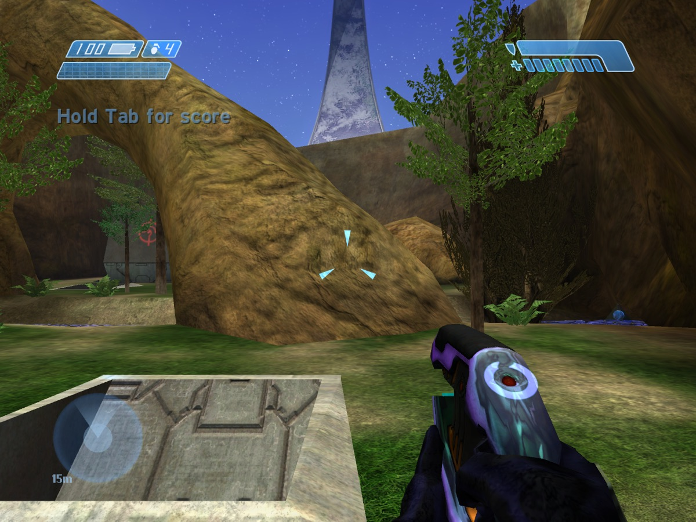</p>

Play Halo: Combat Evolved on your PC, Mac, Steam Deck or phone. Campaign, split screen, System Link, and online games with players on every platform.

It plays like the Xbox game. Everything extra is a setting.

You need your own copy of the game. Chupathingy never includes or downloads Microsoft's files.

## New: Halo MCC maps

Own Halo: The Master Chief Collection on Steam? Its Halo CE Workshop maps now play in Chupathingy, on Windows, Mac and Linux.

- **Browse the Workshop** in the Delta Guide, with each item's picture and page.
- **Link Steam once** by scanning a QR code with the Steam app. The game never sees your Steam password.
- **Maps download straight from Steam**, with no Steam client needed. Once they're in, they play offline or online.
- **MCC maps show in every map screen**, with search, next to your Xbox and PC maps.
- **Host and join MCC games**, on your own machine or a dedicated server.

How it works, and what you need: [docs/mcc.md](docs/mcc.md).

<p align="center">
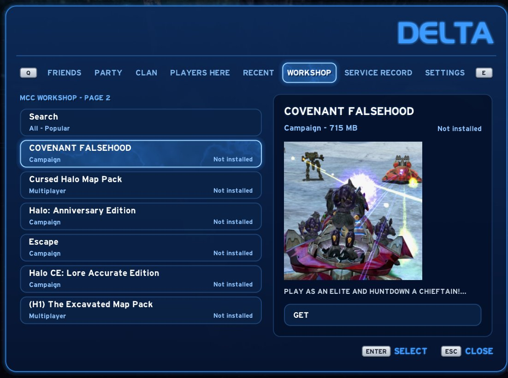
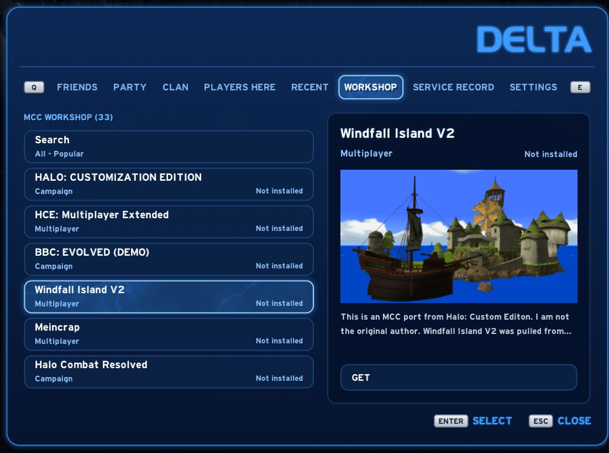
</p>
<p align="center">
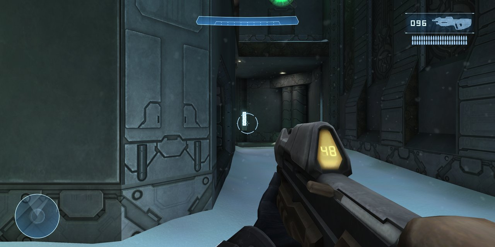
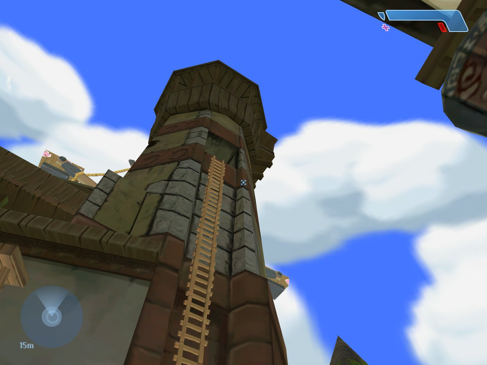
</p>

## Get it

Download the latest release from the [Releases page](https://github.com/ChupathingyCE/chupathingyce/releases/latest).

| System | Download |
| --- | --- |
| Windows 10 or later | `chupathingyce-windows64-release.zip` |
| Mac, Apple silicon or Intel | `chupathingyce-macos-release.zip` |
| Linux | `chupathingyce-linux64-release.AppImage` |
| SteamOS | `chupathingyce-linux64-release.AppImage` |
| Android 9 or later, 64-bit | `chupathingyce-android64-release.zip` |
| FreeBSD | `chupathingyce-freebsd64-release.zip` |

Step-by-step setup for each system, including the Steam Deck, is in [docs/install.md](docs/install.md#getting-started). Older 32-bit PCs and the Linux zip are there too.

The game checks for updates when it starts and asks before installing one. It only installs updates we've signed. On a Mac, it opens the download page instead.

**First start on Windows.** If Windows warns about an unknown publisher, choose **More info**, then **Run anyway**.

**First start on a Mac.** Move ChupathingyCE to Applications and open it. If macOS won't open it, go to **System Settings > Privacy & Security** and choose **Open Anyway**. You only do this once.

## Set it up

1. Start Chupathingy.
2. Pick your Halo: Combat Evolved disc image (`.iso` or `.xiso`) from the original Xbox. Any region works.
3. Wait while it copies the maps (about 2 GB). Then you're in.

Have Halo PC or Custom Edition? The same screen takes the Halo PC disc and the Custom Edition installer too. See [docs/maps.md](docs/maps.md).

On Android, copy the disc image to your phone first.

Where your maps, settings and saves go: [docs/install.md](docs/install.md#where-your-files-go).

## Play online

- **Join a game.** Open **Multiplayer > Online Games**, pick a game and press **A**. Or press **Join** on [stats.chupathingy.org](https://stats.chupathingy.org).
- **Host a game.** In Online Games, press **Y** to create one. Everyone can see it on the list.
- **Invite a friend.** Send them your game's invite link.
- **Join by address.** On **System Link**, press **X** for **DIRECT IP** and type the host's address or name, like at a LAN party. [More](docs/online.md#join-by-address).
- **Play the campaign together.** Host it online from Create Game. [Here's how](docs/online.md#online-co-op).

Chupathingy players on every platform play together. They also play with players on other Halo CE builds when the versions match.

Friends can't get into your game? See [docs/online.md](docs/online.md#if-friends-cant-join).

<p align="center">
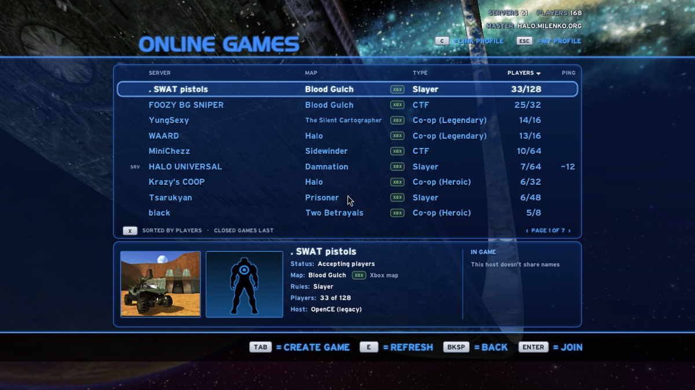
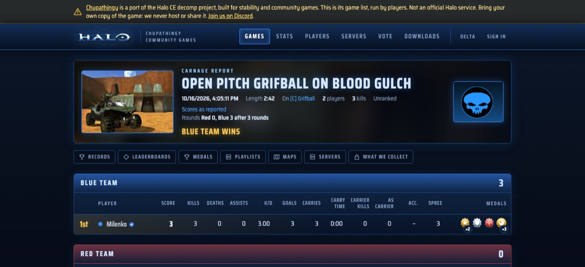
</p>

## Features

**Playing together**
- An Online Games list in the Multiplayer menu
- Our servers around the clock, plus the community's
- Split screen for up to four, and System Link with no internet or account
- Online co-op through the campaign
- Friends, parties and clans in the Delta Guide (F3), with party links you can paste in Discord
- Text and voice chat, and host tools to kick or ban

**Maps**
- Every Xbox map from your disc
- Halo PC, Custom Edition, HaloMD and MCC Workshop maps, side by side with the Xbox ones
- Missing maps download when you join, and each one is checked before it's used
- Community Xbox map packs, like Halo CE+
- Stubbs the Zombie, an early work in progress, from your own Xbox maps (off by default)

**Your stats**
- A carnage report with medals for every finished game
- Service records and leaderboards on [stats.chupathingy.org](https://stats.chupathingy.org)
- Your Delta profile, right in the game

**How it looks and feels**
- The Xbox menus, with Halo PC's settings added
- High-res HUD and text, and widescreen
- Controller layouts, Bumper Jumper included, with button prompts for Xbox, PlayStation and Nintendo pads
- 5.1 and 7.1 surround, and a headphone 3D mode
- The intro and cutscene movies from your disc

<p align="center">
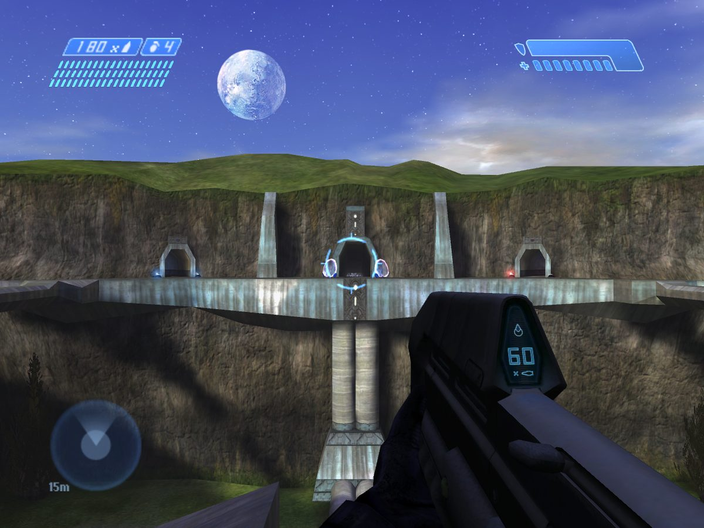
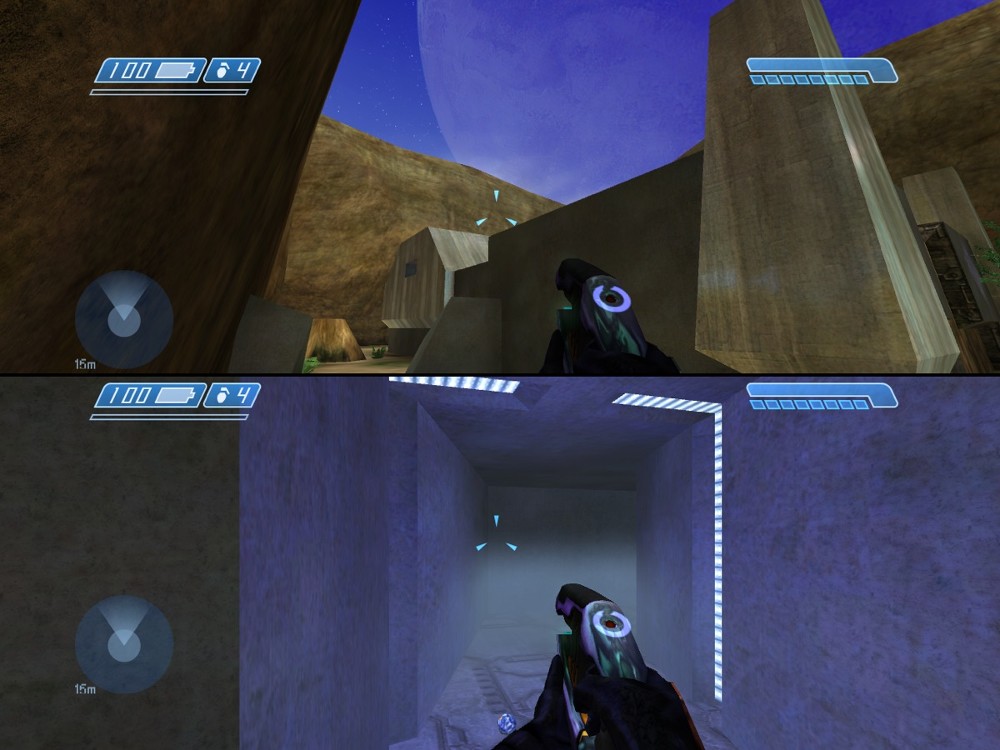
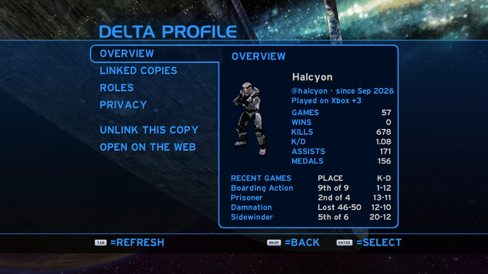
</p>
<p align="center">
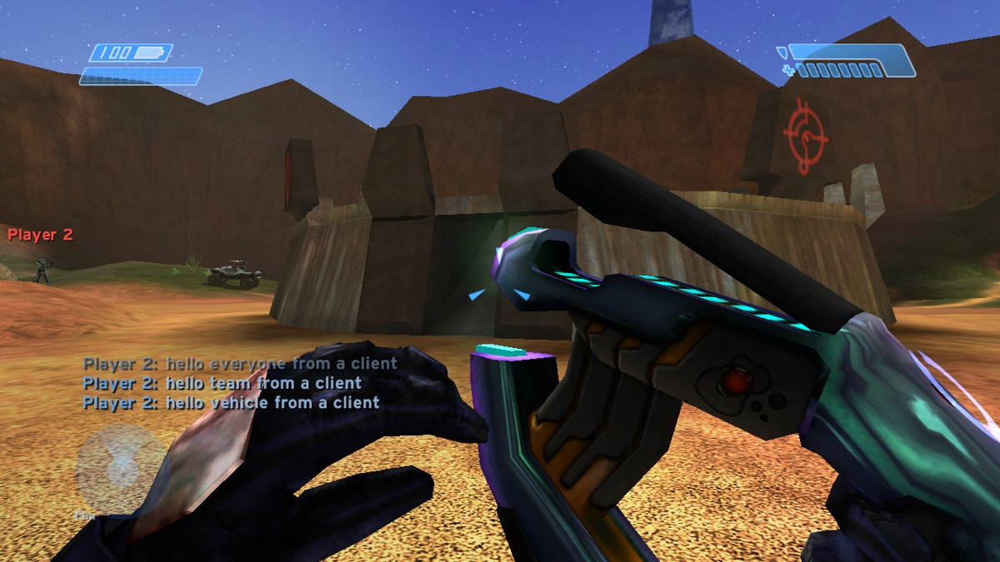
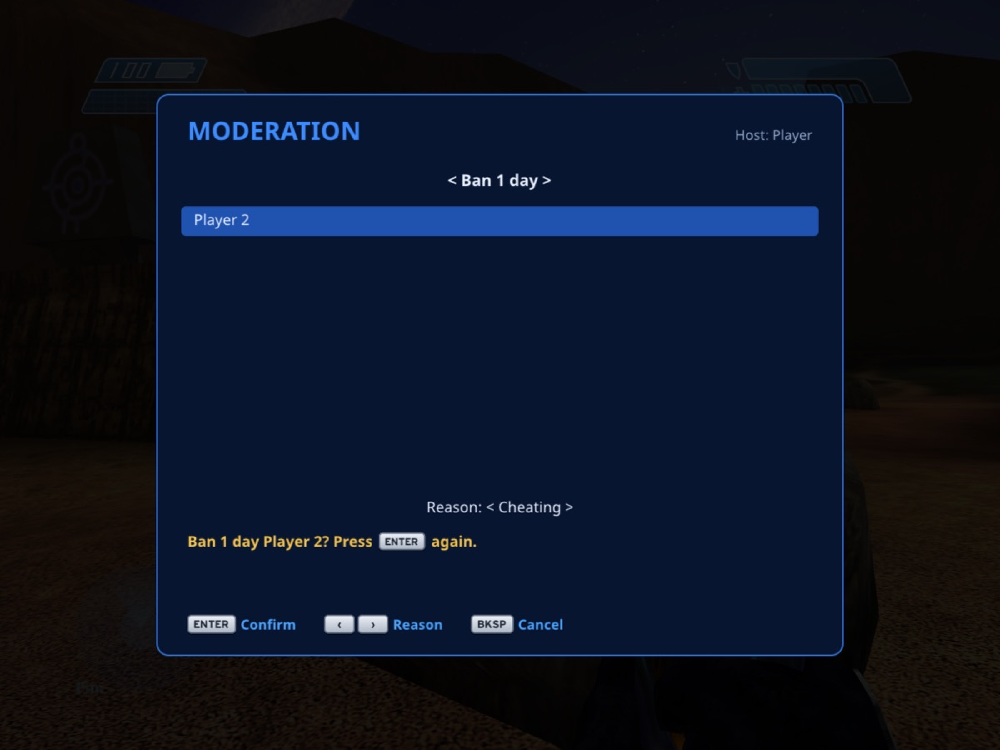
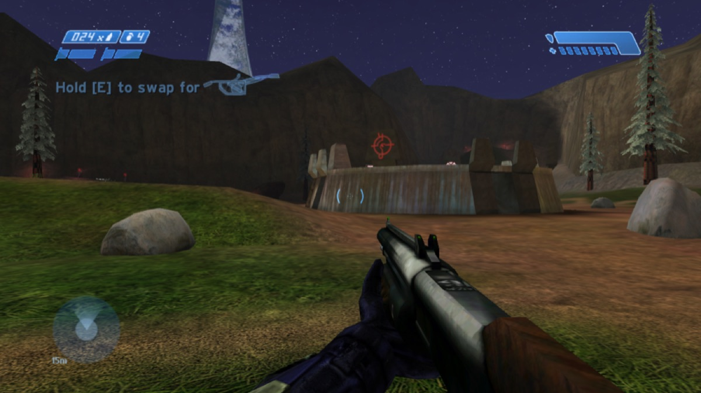
</p>

Every setting, and the `config.toml` file behind them: [docs/settings.md](docs/settings.md). What each platform has: [docs/builds.md](docs/builds.md).

## Consoles

Chupathingy also runs as homebrew on consoles, in the same online games as everyone else. Most are test builds for now.

| Console | Get it |
| --- | --- |
| Original Xbox | [warthog-xbox](https://github.com/ChupathingyCE/warthog-xbox/releases), test builds |
| Xbox 360 | [warthog-360](https://github.com/ChupathingyCE/warthog-360/releases), test builds |
| Wii U | [warthog-wiiu](https://github.com/ChupathingyCE/warthog-wiiu/releases), test builds |
| Nintendo Switch | [warthog-switch](https://github.com/ChupathingyCE/warthog-switch/releases), by thelinkin3000 |
| PlayStation 3 | [warthog-ps3](https://github.com/ChupathingyCE/warthog-ps3), by Mayo1970. Work in progress, no release yet. |

Other developers have ported it to the PSP, PS Vita, PS4, PS5, Xbox Series (UWP), the Steam Link, and the iPhone, iPad and Apple TV. They play in the same games.

<p align="center">
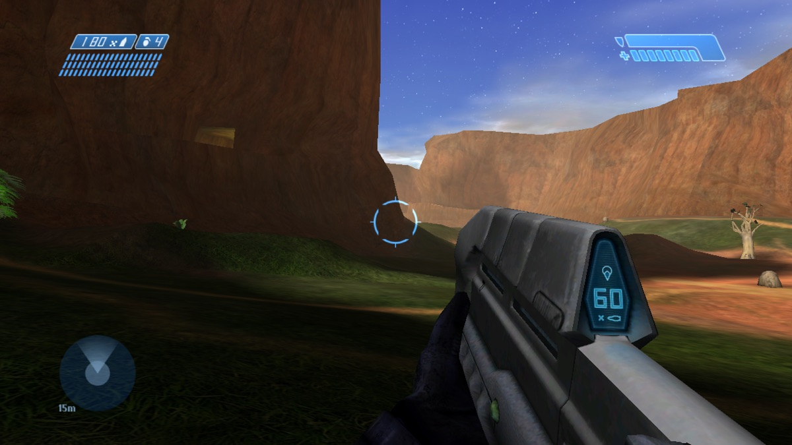
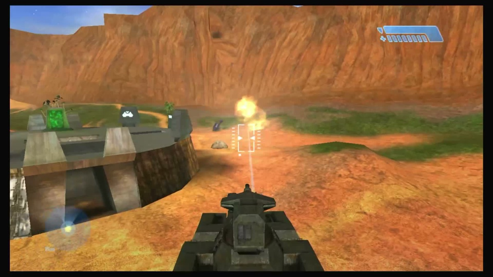
</p>

## Run a server

The dedicated server runs a playlist of games around the clock. It runs on Linux (x86, x64 or arm64, Raspberry Pi too), on 64-bit Windows, or in Docker, and needs no port forwarding. It can host MCC Workshop maps too. Start with [server/README.md](server/README.md).

## Builds

Releases are the stable builds, and the game updates itself from them. Want the newest changes early? Pick an update channel in Settings > Network Setup > Updates, or on the setup screen's Updates tab:

- **Release** (the default) gets releases only.
- **Testing** gets test builds first, and may have bugs.
- **Nightly** gets a build of main every night, and the test builds too.

Testing and Nightly still get each release. You can switch back to Release anytime. The game never installs an older build, so after a test build you stay on it until the next release comes out. More in [docs/install.md](docs/install.md#which-build).

## Help

Ask on the [Discord](https://discord.gg/chupathingy). It's also where people find games and report bugs. You can file bugs in [issues](https://github.com/ChupathingyCE/chupathingyce/issues) too.

Fixes for common problems, and how to send your logs, are in [docs/help.md](docs/help.md).

## Build it yourself

You need Python 3, [ninja](https://ninja-build.org/) and clang. You don't need the Xbox SDK.

```sh
python3 configure.py
ninja
```

Every target and option is in [docs/building.md](docs/building.md).

## Generative AI

The decompilation this project is built on, and the port it began as a fork of, were made with heavy use of generative AI. Chupathingy has its own code and releases now, but a lot of that earlier work is still in it.

We use AI tools the way developers use any other tool. A person decides what to build, reviews every change, tests it, and is responsible for it. Nothing is handed to an AI to build from start to finish without a person involved. We're also working through the code we inherited to clean up what reads as machine-written: comments that only repeat the code, unclear names, and changes nobody can explain.

If you contribute, the same applies to you: see [CONTRIBUTING](CONTRIBUTING.md#using-ai-tools).

## License

Chupathingy is free software under the GNU General Public License, version 3 or later. It comes with no warranty. Releases up to 0.7.5d stay under CC0. The details, and the permission for console SDKs, are in [docs/license.md](docs/license.md).

The license covers Chupathingy's code only. It gives no rights in Halo or anything else Microsoft owns.

## Support

Chupathingy is free and always will be. Support through
[Ko-fi](https://ko-fi.com/milenko) or [Patreon](https://www.patreon.com/c/chupathingy)
goes to running the site and the servers. If there's a specific developer or
port you'd like to support, ask them: they may not be part of our community.

## Credits

- Chupathingy: [Milenko](https://github.com/MrMilenko) and contributors.

<details>
<summary><b>Contributors</b></summary>

Fixes from other people's pull requests and forks, taken into Chupathingy
with their authors credited in each commit.

- [Tyberious](https://github.com/Tyberious): Xbox ADPCM decoding
  without the 344 Hz buzz, vertex constant serials that never wrap, pose
  snapping for frame interpolation, and the clip-space position kept on the
  desktop (no more first-person vertex spikes).
- [thelinkin3000](https://github.com/thelinkin3000): the motion sensor for
  three and four local players (a split screen crash), and split screen
  dividers where the views meet on a wide screen.
- [xshxdex98](https://github.com/xshxdex98) ([DamnationCE](https://github.com/xshxdex98/DamnationCE)):
  the pause menu's QUIT by mouse or keyboard, and lens flares out of view no
  longer tested.
- [zimm3rmann](https://github.com/zimm3rmann): visibility test slot 0 kept
  apart from the scratch query (lens flares sharing a result).
- [nsafran1217](https://github.com/nsafran1217): no hang
  where the visibility results buffer cannot be mapped.
- [saulob](https://github.com/saulob): the first menu frame's colors.
- natsu-anon: the cursor hidden during play.
- [lantos1618](https://github.com/lantos1618): no ghosting in the zoom effect
  at high resolutions; on macOS, Command-W does not quit and Command-Q asks
  twice.
- [pfista](https://github.com/pfista): projectile trails
  ready before a weapon's first shot.
- [JoshRob297](https://github.com/JoshRob297): hosts that run their own games
  (the dedicated servers) no longer refuse every join after one arrived as a
  game ended.
- [HiIAmMoot](https://github.com/HiIAmMoot) (Mootjuh): the Android menus by
  touch, and starting a multiplayer game alone (`game.start_with_one_player`,
  first `debug.solo_game`), now on by default.
- [oatkrs](https://github.com/oatkrs): crisp windowed rendering and no
  audio cut-outs on macOS, and a corrupted script thread dropped instead of
  halting the game.
- [Renkoto](https://github.com/Renkoto): the FreeBSD port (`port/unix`,
  `ninja freebsd64`) and its Delta platform, 13.
- [JizzyRivers](https://github.com/JizzyRivers): the iOS port (`port/ios`),
  Custom Edition maps and the Map Browser on the original Xbox, and the
  consoles' start-up screens and updates.
- [startupfoundry](https://github.com/startupfoundry) and
  [pastudan](https://github.com/pastudan) (OpenH1): camera shake, particle
  streams, change colors and camo smoothed between ticks, a faster audio
  resampler and limiter, a lighter scope zoom at high resolutions, and a
  map's first frame drawn through every shader, which lists the stock maps'
  shaders and makes bgfx's pipelines before play.
- goatbutt and the OpenH1 team: the high-res text drawn from distance
  fields (sharp at any size), the fixed benchmark, the variable refresh
  cap and the camouflaged weapon fix.
- [hkmodd](https://github.com/hkmodd) (OpenCE): HDR (`display.hdr`): the
  OpenGL half-float path and the tone mapping curves, from his OpenCE pull
  request 280 as it stood before OpenCE's license change. The glows past
  white and the brightness in nits follow goatbutt's and the OpenH1 team's
  HDR.
- chestahh (GulchCE): lens flares and light
  glows back on AMD graphics, less stutter the first time a texture is drawn
  on Windows, host cheat and shadow setup fixes, and the Halo MCC map
  loader: MCC Workshop and MCC install maps, their scripts, HUDs, effects
  and campaigns.
- PeterRichardsonGolf and the other GulchCE contributors: the Steam
  Workshop catalog with its items' titles and collections, and the MCC
  sharing rules.
- mOTA-lEV ([OpenCE-Faber](https://github.com/SutlabSol/OpenCE-Faber)):
  projectiles and damage that forget objects deleted under them.
- [bitmoda](https://github.com/bitmoda) (mastercheese's OpenCE fork): the
  clock read only when something needs it.
- theLlamaNet: the Android on-screen touch
  controls, through JoshRob297's halo-ce-touch.
- Guven (GuvenHuso) and hispanorum (OpenCE): the debug camera flown by
  mouse and keyboard, and its saved spot kept for the player in view
  (written from a description of their work).

</details>

- Fonts: Cyborg Interface Gothic, the font of the game's text and of our
  own screens, by fizzy, made to match Halo's interface font from Overpass
  and glyphs of their own (SIL OFL); the menus' titles in Chupathingy
  Titles, Newtown by Roger White (public domain), respaced to sit where
  Halo's titles do (SIL OFL);
  [Overpass](https://github.com/RedHatOfficial/Overpass) (SIL OFL);
  [Noto Sans](https://fonts.google.com/noto) (SIL OFL), for the letters
  Cyborg lacks, and
  [Kenney's Input Prompts](https://kenney.nl/assets/input-prompts) (CC0); the
  scoreboard's platform logos are one-color marks from
  [Simple Icons](https://simpleicons.org) (CC0) and Wikimedia Commons (public
  domain), plus our own Xbox 360 ring and Wii U GamePad; the names and logos
  are their owners' trademarks, used only to identify platforms. The same
  marks make the platform badges at the top of this page. [BSD Daemon used with permission.](http://www.mckusick.com/copyright.html)
- The service record is our own (on the site since September, and in the
  Delta Guide's SERVICE RECORD). The Guide's local career totals and top
  medals (`port/linux/src/service_record.c`) follow the career record in
  mOTA-lEV's [OpenCE-Faber](https://github.com/SutlabSol/OpenCE-Faber),
  used under GPL-3.0 with his permission.
- Controller button icons by snapchipper, CC0 (`port/assets/prompts`).
- HD controller buttons (the original Xbox controller's, PlayStation's and
  Switch's) by DKrumpp, used with permission (`port/assets/buttons_hd`); not
  under our license.
- The Xbox's 3D sound and reverb (`audio.hrtf`, `audio.reverb`): the HRTF
  measured on an Xbox and the reconstruction of its DSP reverb are
  [OpenH1](https://github.com/OpenH1/OpenH1)'s work, brought into
  [GulchCE](https://github.com/chestahh/GulchCE) by chestahh
  (`port/linux/src/dsound_xbox_*`,
  [docs/reading/xbox_audio.md](docs/reading/xbox_audio.md)).
- High-res HUD art on the Xbox maps: Aerocatia's and Jessie's HUD art from
  [Halo PC Restored](https://github.com/Aerocatia/halopc-restored) (release
  r220), used with Aerocatia's permission on the condition that both are
  credited; `port/assets/hud/NOTICE.md` lists which files are theirs.
- HD HUDs on Custom Edition maps (MCC's "0.5 HUD scale" and Chimera's
  "force HUD use high resolution scale" flags): ugoboom, tested with
  Aerocatia's [halopc-restored](https://github.com/Aerocatia/halopc-restored)
  resource maps.
- Stubbs mode reads Stubbs the Zombie's maps with layouts from Sigmmma's
  [reclaimer](https://github.com/Sigmmma/reclaimer) (GPL-3.0). The maps
  aren't included.
- Grifball courts: Bomb plays on SlappyThePirate's "Grifball Beta" court
  (`grifball.map`), which is open to use with credit; the map is not
  included.
- HaloMD map names: from [MacGamingMods](https://macgamingmods.com)' public
  HaloMD mod list, so the menus can show each map's own name.
- Missing Custom Edition maps: downloaded from the community map
  repositories, as Chimera uses them (maps.halonet.net, the HAC2 map
  repository, and its mirrors). Chupathingy's downloader is its own code;
  Chimera showed where the repositories are and how they answer.
- [Chimera](https://github.com/SnowyMouse/chimera) by SnowyMouse, its
  current developers Aerocatia and Cambidd, and contributors (GPL-3.0):
  Halo PC fixes reference, the compressed map format, and the Lua API that
  mods' scripts use (`lua.scripts`), adapted from Chimera's own in
  `port/linux/game/lua_chimera_api.c` (GPL-3.0-only).
- [OpenSauce](https://github.com/HaloMods/OpenSauce) by Kornner Studios
  (GPL-3.0): its Halo Custom Edition message definitions, the reference for
  the fields Custom Edition players' clients are sent; its Halo PC object
  structures and engine addresses, the reference for the memory Lua
  scripts read (`port/linux/game/lua_twiddlings_objects.c`,
  `port/linux/game/lua_opensauce.c`); its cache header, tag definitions and
  memory upgrades, the reference for how OpenSauce maps are read and
  checked (`port/linux/game/opensauce_map.c`,
  `port/linux/game/tag_schema_opensauce.c`).
- Security reports: nickarcade, who reported the dedicated server's control
  panel permission gap fixed in #462.
- Libraries: SDL3, stb, Mbed TLS, miniupnpc, KCP, Lua, tomlc17, musl's maths,
  Expat, Monocypher, zlib, Zstandard (BSD-3-Clause), the LZMA SDK's decoder
  (Igor Pavlov, public domain), SMAA, Project Nayuki's QR Code generator
  (MIT), and msdfgen by Viktor Chlumsky (MIT; its algorithms translated to
  C by goatbutt and the OpenH1 team, `port/third_party/msdfgen`). Their licenses are
  beside them in `port/third_party`. The 64-bit desktop builds' test
  renderer uses bgfx, bx and bimg by Branimir Karadžić (BSD-2-Clause), with
  glslang and SPIRV-Cross (Khronos, BSD-3-Clause and Apache-2.0), fetched
  at build time (`tools/bgfx_build.py`). Every download carries their notices
  and full license texts in one file, `THIRD-PARTY-NOTICES.txt`.

<details>
<summary><b>Findings and testing</b></summary>

- Sabriel and ugoboom: the Halo PC map reports and regression lists behind
  most of the Custom Edition fixes.
- Sabriel, roundzabout and Mega: Grifball playtesting and the bugs and
  tweaks it turned up.
- Testing, with bug reports and logs over many builds: FASTNOOB, FLTHY, Fujibayashi Kyou, Mega, OpenRift, roundzabout, Sabriel, Shadow Phoenix, snapchipper, TanFlo, ugoboom and Wonka.
- Console testing on real hardware (original Xbox, Xbox 360, Wii U and
  Switch): BoganEsky, claire, deeechrome, grizz_85, JanusDuo, LD50 II, LukeShortCloud, magoostus, re4thewin, The Real Napsta, TomiG117, UncookedMoa, X-ISO, xpb4me and Xiyl.

</details>

## Where it came from

Chupathingy is a port of the Halo: Combat Evolved decompilation ([punpckhdq/halo](https://github.com/punpckhdq/halo) and [bnunu/halo-1](https://github.com/bnunu/halo-1)). It began as a fork of OpenCE, an earlier port of that decompilation (the code is theirs up to October 9, 2026), and has had its own code, releases and community since.

- The decompilation: [punpckhdq/halo](https://github.com/punpckhdq/halo) and
  [bnunu/halo-1](https://github.com/bnunu/halo-1), of the Xbox build 2342.
- The port Chupathingy began as a fork of: OpenCE and its contributors, up to
  October 9, 2026.
- Later fixes taken from OpenCE (CC0), with their authors kept in the
  history: startupfoundry, xshxdex98, hkmodd, eltanschauung, justinfilip,
  bertoaldo, addisonbair, thelinkin3000, bmanturner, chestahh, FDervish,
  frankyfife, actes2, crowtrx and MrBruh (by their GitHub handles). The
  wire format tool (`tools/network_format.py`) is addisonbair's and MrBruh's.
- The icon: MrBruh's helmet from OpenCE, with tusks.
- [bnunu](https://github.com/bnunu): Custom Edition map
  findings from the custom-edition-maps branch, credited in the commits they
  led to, and the larger texture cache for Halo PC maps, which that branch had
  first.
- MrBruh (build-145's Custom
  Edition loader, from DamnationCE's work by
  [xshxdex98](https://github.com/xshxdex98)): maps that need OpenSauce refused
  with a clear reason, the missing-map message when joining, and the
  `custom_maps\<name>` naming our hosts and clients share with OpenCE.

---

<sub>Chupathingy is an unofficial fan project. It isn't affiliated with or endorsed by Microsoft, Xbox Game Studios, Bungie or Halo Studios. Halo is a trademark of Microsoft. No game files are included: you bring your own copy. The code is released under the GNU GPL, version 3 or later (see [License](#license)).</sub>

---

<a id="opence"></a>
## OpenCE

[OpenCE](https://github.com/OpenCommunityEdition/OpenCE) is the port of the
Halo: Combat Evolved decompilation (the Xbox build 2342, from
[bnunu/halo-1](https://github.com/bnunu/halo-1), a fork of
[punpckhdq/halo](https://github.com/punpckhdq/halo)) to Linux, Windows and
Android, which ChupathingyCE and this fork build on. Everything here comes
from it first:

- **The game, running natively** (no emulator): the decompiled game's C
  sources, compiled as they are, on a platform layer that stands in for the
  Xbox (Direct3D 8 on OpenGL, DirectSound and XInput on SDL3, files,
  threads, sockets), on Linux, Windows and Android (an ILP32 AArch64 guest
  in a 64-bit app).
- **Multiplayer**: system link games of up to 128 players on up to 128
  machines, Linux, Windows and Android together; internet play by invite
  link with no server of the project's; a new netcode in which each machine
  moves its own player at once and the host decides
  ([port/linux/NETCODE.md](port/linux/NETCODE.md)); voice chat; votes to
  kick; network co-op.
- **The PC version's menus**, the Server Browser, high-resolution HUD, text
  and controller buttons, widescreen, frame interpolation, field of view
  and viewmodel settings, and every setting in `config.toml`
  ([port/linux/README.md](port/linux/README.md#settings)).
- **Halo PC Custom Edition maps**, refused with a clear reason when they
  need OpenSauce, and **Halo MCC maps** from Steam's Workshop or a package
  ([docs/mcc_maps.md](docs/mcc_maps.md)).
- **New game types**: SWAT, Infection, Gun Game and Hardcore.
- **Touch controls** on Android, and the menus by touch.
- **Its own browser build** (`ninja web`, `tools/web_build.py`,
  [port/web/README.md](port/web/README.md)), played at
  [halocombatevolved.com](https://halocombatevolved.com/): browsers play
  each other in rooms over WebRTC, and the native builds take a browser's
  WebRTC on their internet play's socket. It is in this repository beside
  this fork's browser build (`ninja browser`), which is the one this fork's
  site plays.
- **A dedicated server** in the game itself (`halo --server`,
  [docs/dedicated_server.md](docs/dedicated_server.md)): a rotation of
  games, a web admin page, RCON, and master servers that list it under the
  server browser's DEDICATED
  ([docs/master_protocol.md](docs/master_protocol.md)).
  [Zenith Hosting](https://zenith.hosting/host/opence) is OpenCE's official
  host for its dedicated servers (OpenCE Fleet): a server in one click,
  managed from one dashboard.
- **Updates itself** from its releases.

Its own documents: [port/linux/README.md](port/linux/README.md) (controls,
menus, settings, internet play, how the port operates),
[port/windows/README.md](port/windows/README.md),
[port/android/README.md](port/android/README.md) and
[AGENTS.md](AGENTS.md) (the project's layout and rules). Its Discord:
[discord.gg/9gqcHyr5km](https://discord.gg/9gqcHyr5km).

### Profiling builds (OpenCE)

A profiling build records where the game spends its time, for
[Perfetto](https://ui.perfetto.dev/) and `tools/net_report.py`. The 32-bit
Linux and Windows builds and the Android app have one; the 64-bit builds,
the dedicated server and the browser build are built as without the option.

1. Enter `python configure.py --profile`, then build as usual (not with
   `--pgo=train`).
2. Start a recording: enter `profile_record` in the console (or the telnet
   console), or set `debug.profile_record = true` in `config.toml`. To
   record each game of a session, also set
   `debug.profile_record_when = "game"`.
3. Stop it: enter `profile_stop`, load another map, or quit.

| Command | Result |
| --- | --- |
| `profile_record [seconds]` | Starts a recording. With a number of seconds, it stops after that time. |
| `profile_stop` | Stops the recording. |

The game writes numbered `.part<n>.json` files under `profiles/` in its data
folder and logs their paths; they stay after the recording stops. Logs go to
standard error; a Windows release build without standard error writes them
to `halo.log` next to `halo.exe`. `python tools/net_report.py
<recording.part1.json>` reads a recording as tables, and writes
`<recording>.summary.txt`, a short text file.

`debug.profile_memory` sets a recording's memory in MB (default 256, from 4
to 1024). A recording has no length limit: the game writes a part each time
the memory is full. See the settings in
[port/linux/README.md](port/linux/README.md). On Android, the files are in
`/sdcard/Android/data/net.fractumseraph.halo/files/profiles/` (copy them with
`adb pull`). A profiling build plays with normal builds.

`python tools/ci_build.py linux profile` builds it as the GitHub workflow
does; the workflow builds it only in a run started by hand with its
`profile` box ticked.

## Testing

The tests are listed in [AGENTS.md](AGENTS.md) ("Testing"). Most run
without the game data, in GitHub Actions too.

One check needs the retail maps, so it runs on your own computer (or on a
self-hosted runner), not in GitHub Actions: `tools/net_compare.py` plays
two builds together in a network game on one computer and checks that they
stay in step. Run it when a change can alter how a build calculates the
game, as a change to the simulation, the compiler or the maths does,
before it is merged. For example, to check a build with such a change
against a build without it:

```sh
python tools/net_compare.py --a build/linux/halo --b <other checkout>/build/linux/halo \
    --data <folder with maps/> --maps bloodgulch,beavercreek,hangemhigh --swap
```

Each game prints PASS or FAIL. A FAIL names the first player, tick and
value that differ. Refer to "Comparing two builds" in
[port/linux/NETCODE.md](port/linux/NETCODE.md).
